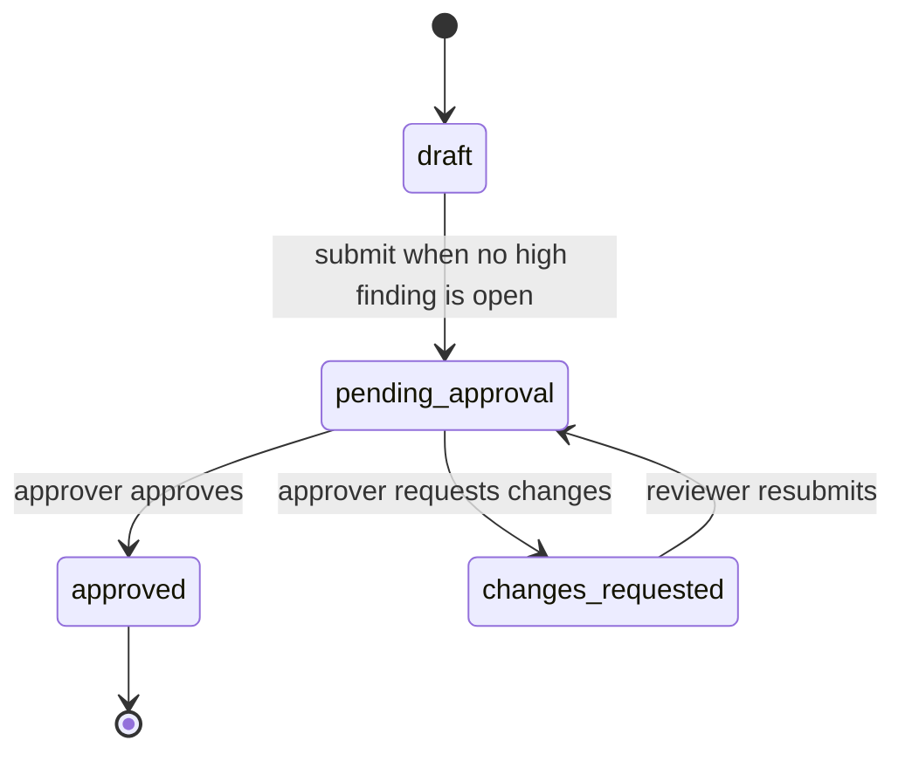

## Overview

BrandGuard AI is a MERN application for checking marketing copy against a curated Rules and Facts library, managing finding status, and routing reviews through a reviewer/approver workflow. The React/Vite client calls the Express API; MongoDB stores users, reviews, rules, facts, and an append-only audit log.

## Data flow

1. A signed-in reviewer submits copy to `POST /api/reviews`; the server stores the deterministic/optional AI findings and a `review_created` audit event.
2. Users can change finding statuses while a review is `draft` or `changes_requested`, and add append-only comments in any workflow state.
3. A reviewer submits with `POST /api/reviews/:id/submit`; an open high-severity finding blocks submission.
4. An approver uses `POST /api/reviews/:id/approve` or `/request-changes`; each transition is conditionally updated and recorded in `AuditLog`.
5. The client reloads the saved review after actions and reads oldest-first audit pages from `GET /api/reviews/:id/audit`.

## Key decisions

- Finding comments are embedded in their finding because they are always read and written with that review; author name and role are snapshots.
- `AuditLog` is a separate append-only collection so activity remains a durable history as review status changes.
- The review workflow uses conditional updates on the expected state to prevent duplicate simultaneous submissions or decisions.
- JWTs live in client local storage; each API call attaches the bearer token. Public review and audit responses do not include email or password hashes.

## Data model

- **Rules** and **Facts** are separate MongoDB collections so approved guidance and verified claims can be maintained and queried independently. Each uses a unique code as a stable evidence reference.
- **Users** store a name, unique email, password hash, and the `reviewer` or `approver` role. Password hashes are excluded from normal queries and public user responses omit email.
- **Reviews** store submitted text, optional PDF/DOCX source metadata, AI chunk metadata, findings, summary counts, workflow state, creator/submission/decision references, timestamps, and the current decision note. Findings are embedded subdocuments because they belong to one review; each contains status history fields and an append-only comments array with author, author-name/role snapshots, text, and timestamp. The review engine keeps the top 1,000 findings by severity and source position and records whether additional findings were truncated.
- **AuditLog** stores one immutable document per event: review/finding references, actor name and role snapshots, action, transition values, matched-text excerpt, optional note, and creation time. It has no update or delete path.

### Approval workflow and permissions



Finding status changes are available in `draft` and `changes_requested`. They are locked in `pending_approval` and `approved`. Finding comments are allowed in every state. Resubmission retains the previous decision fields until a new approver decision replaces them; the audit log preserves each transition.

### Compliance report export

`GET /api/reviews/:id/report` requires authentication and accepts `includeFullText` (default false), `includeComments` (default true), and `includeAudit` (default true). Invalid boolean query values return the standard `{ error }` response. Reports omit account emails, password hashes, and tokens; submitted text is absent unless `includeFullText=true`. `POST /api/reviews/report-summary` accepts 1–25 review IDs and returns compact rows with missing IDs listed separately; it never returns findings detail or review text.

`services/reports/buildReport.js` is a pure builder. It receives populated review data, up to 500 oldest-first audit entries, library title records, options, and a generation time. Its SHA-256 fingerprint hashes canonical finding fields (type, matched text, offsets, evidence code, status) plus workflow status and `decidedAt`. That digest is stable for the same review state and changes when finding status or the decision state changes. It is only a tamper-evidence aid: it is not a digital signature, does not authenticate the report author, and cannot prove that source content or library records were truthful.

Each valid report export attempts one append-only `report_exported` audit event containing the export options and fingerprint. A failed audit write is logged without blocking report delivery. The report disclosures describe AI coverage, disabled checks, approval state, text truncation, finding caps, and the dependency on the current Rules/Facts library. PDF output is produced by the client browser's print dialog, not by a server PDF library.

| Capability | Reviewer | Approver |
|---|---|---|
| Create a review and read review/history data | Yes | Yes |
| Change finding status in draft or changes requested | Yes | Yes |
| Add a finding comment in any workflow state | Yes | Yes |
| Submit or resubmit a review | Yes | Yes |
| Approve or request changes while pending | No | Yes |
| Read the review audit trail | Yes | Yes |

## Review engine

The deterministic review pipeline splits submitted text into sentences while preserving source offsets, checks each sentence against active brand rules, runs the built-in quality checks, identifies factual claims, and compares those claims to the approved Facts library. It combines findings, suppresses redundant verification warnings when a fact mismatch already explains a sentence, sorts findings by source position, and calculates severity, verification counts, and readability metrics.

Deterministic checks run first so explicit brand rules and approved facts provide repeatable, auditable results. A claim is only called a fact mismatch when a relevant approved fact exists and its numbers disagree; without supporting evidence, it is marked “Needs verification” rather than false. Each finding links to the matching Rule or Fact code and evidence excerpt when available.

The review engine runs rules, quality checks, and fact checks before optionally invoking the AI layer. AI findings are advisory additions; deterministic findings take precedence when spans overlap. Quality checks reserve their source spans before AI validation, and the validator still accepts citations only for known Rule/Fact codes. Invalid JSON, unknown codes, unsupported text spans, timeouts, and provider failures produce deterministic-only results with `aiStatus: unavailable`. Turning the AI toggle off skips provider calls (`aiStatus: disabled`). Quality checks can separately be disabled with `qualityChecks: false` when creating a review. Exact-span findings from different categories remain side by side; a same-category quality finding is suppressed when a rule finding already covers that exact span.

### Quality checks

All checks operate on plain text and emit a stable `check` evidence reference, measured excerpt, exact matched span, category, severity, and suggestion. They run before AI and contribute to total/high/medium/low summary counts, but not `needsVerification`.

| Code | Category | Default severity | Threshold |
|---|---|---:|---|
| READ-01 | Readability | Medium / high | More than 30 words (medium); more than 45 (high) |
| READ-02 | Readability | Low | Flesch-Kincaid grade above 16, with at least 12 words |
| READ-03 | Readability | Low | At least 2 possible passive constructions in a sentence; heuristic regex |
| JARGON-01 | Readability | Low | Any term from `server/src/seed/jargonTerms.json` or configured terms |
| LINK-01 | Accessibility | Medium | Generic link text: “click here”, “here”, “read more”, “learn more”, “link”, or “this” |
| LINK-02 | Accessibility | Low | Raw URL used as Markdown link text exceeds 60 characters |
| ACC-01 | Accessibility | Low | At least 3 consecutive all-caps words of 3+ letters, excluding the acronym allowlist |
| ACC-02 | Accessibility | Low | Line begins with an emoji or decorative symbol used as a bullet/separator |

The English syllable estimator counts vowel groups, subtracts a silent final “e” and adds a syllable for a consonant + “le” ending. Review readability metrics use the Flesch Reading Ease and Flesch-Kincaid formulas; the sentence threshold and jargon/acronym lists are configurable with `QUALITY_*` environment variables. Metrics are rounded to one decimal place, and empty input yields zeros. These plain-text checks are intentionally explainable heuristics and may need human review.

## Insights API

`GET /api/insights` requires a bearer token and accepts `days` (integer 1–365, default 30), `scope` (`all` or `mine`, default `all`), and optional exact case-insensitive `brand`. `mine` filters by the authenticated user's `createdBy`. The API loads at most 2,000 reviews created in the period, projects only workflow, finding, ownership, date, brand, and readability fields, then aggregates in JavaScript. It returns a `truncated` flag when that cap is reached. Day buckets are used for periods up to 31 days; longer periods use Monday-starting UTC week buckets. Empty time buckets are emitted as zero-valued records. Issue titles come from Rule titles, Fact statements, and quality-check titles, with the evidence code as fallback. `GET /api/insights/brands` returns distinct brand names with counts.

Readability trend metrics use `null` for buckets without data, allowing charts to skip missing points; legacy reviews without metrics remain absent rather than receiving fabricated zeros.

## Document extraction

`POST /api/documents/extract` is mounted at `/api/documents` and requires authentication. It accepts one in-memory multipart file under `file`. Multer enforces the upload size and file/field counts; the rate limiter allows 20 requests per 15 minutes per authenticated user. The extractor identifies PDF by `%PDF-` and DOCX by ZIP directory contents including `word/document.xml`, then parses in a bounded child process that is terminated after 15 seconds. PDF text comes from `pdf-parse` (PDF.js-based JavaScript implementation without native binaries); DOCX raw text and parser messages come from Mammoth. Mammoth receives only the upload buffer and raw-text extraction does not render links or access external files. No file or extracted text is persisted.

Optional environment variables are `MAX_UPLOAD_MB` (5 MB default), `MAX_DOC_CHARS` (60,000 default), and `MAX_PDF_PAGES` (100 default). The response includes a sanitized filename, detected `fileType`, PDF `pageCount` (otherwise `null`), `charCount`, `truncated`, warnings, and text. Long text is truncated; PDFs over 50 pages receive a warning. Status codes are 400 for missing/empty/unsupported/malformed multipart data, 413 for an upload over the byte limit, 422 for scanned/image-only, corrupt, password-protected, timed-out, or over-page-limit documents, and 429 for rate limiting. CORS allows the configured `CLIENT_URL` origins with the existing `Authorization` and `Content-Type` headers.

Trimmed response example:

```json
{
  "period": { "from": "2026-10-01T00:00:00.000Z", "to": "2026-10-31T00:00:00.000Z", "bucket": "day" },
  "totals": { "reviews": 12, "findings": 38, "bySeverity": { "high": 4, "medium": 20, "low": 14 }, "byStatus": { "open": 17, "accepted": 16, "dismissed": 5 }, "acceptanceRate": 0.8 },
  "topIssues": [ { "key": "TERM-01", "title": "Use the approved product spelling", "category": "terminology", "kind": "rule", "count": 7, "severity": "medium", "accepted": 4, "dismissed": 1, "open": 2, "lastSeen": "2026-10-28T11:24:00.000Z", "exampleText": "NimbusNotes" } ],
  "allIssues": [], "byCategory": [], "overTime": [], "readabilityTrend": [],
  "workflow": { "draft": 5, "pending_approval": 2, "approved": 4, "changes_requested": 1, "avgHoursToDecision": 3.5 },
  "truncated": false
}
```

### AI-assisted analysis and guardrails

`services/ai/aiProvider.js` wraps Google's official `@google/genai` Node SDK and selects `AI_MODEL` from server environment configuration (default `gemini-3.8-flash`). Long documents are split at paragraph, sentence, and then word boundaries; each AI chunk is validated against its own source text and its finding offsets are shifted back to the original document. Analysis proceeds sequentially within `AI_MAX_CHUNKS` (5), `AI_CHUNK_CHARS` (6,000), and `AI_TOTAL_TIMEOUT_MS` (45,000) defaults. Failed or skipped chunks preserve successful AI findings and set `aiStatus: partial`; if no chunk succeeds, AI status is `failed`. The validator strips optional Markdown fences, parses JSON, verifies evidence codes and exact source text, derives offsets from source text, and removes deterministic duplicates/overlaps. Rewrites are returned as drafts and are never considered evidence or approval.

AI is enabled by default in the input panel but can be disabled per review. API keys remain server-side. Pasted text is limited to 10,000 characters; document reviews accept up to `MAX_DOC_CHARS` (60,000 default). Review creation is rate-limited. Each provider call logs elapsed time. AI failures leave deterministic findings available and the UI explains partial or failed analysis. AI outputs can still be incomplete or make poor editorial suggestions, so reviewers must verify suggestions before publication.

## Brand libraries and moderation

`Brand` owns a case-insensitive unique name, stable unique slug, optional description, creator, and the single default-brand marker. `Rule` and `Fact` use a required `brand` reference and unique compound `(brand, code)` indexes. The brand migration removes legacy global `code_1` indexes, assigns existing library records to Nimbus Notes, marks existing records active (preserving `Rule.active=false` as archived), attaches matching Nimbus Notes reviews, and creates the compound indexes. Legacy reviews without a `brand` remain valid and resolve through the default library when reports or review processing need it.

Only status `active` library records for the review's brand are loaded for deterministic matching and passed into the existing AI prompt/validator. New API proposals start as drafts and cannot affect findings until approved. A proposed lifecycle is:

```text
draft ──approve──> active ──archive──> archived ──restore──> active
  └──reject (required note)──> rejected
```

Reviewers and approvers can propose entries; reviewers can edit their own drafts. Approvers can edit draft and active items, approve/reject drafts, and archive/restore. Self-approval uses `ALLOW_SELF_APPROVAL`. Every create, edit, approval, rejection, archive, and restore writes an immutable `LibraryChange` with actor snapshots and changed field names. Brand names are not rewritten into historical `Review.brandName` snapshots after a rename; that preserves old review/report display records.

The brand and library APIs are mounted at `/api/brands`, `/api/rules`, and `/api/facts`. `GET /api/brands/:id/library-log` is newest-first and paginated. List endpoints default to the default brand and active status; `status=all` includes every lifecycle state. `POST /api/rules/test` uses the production rule matcher without persistence and is rate limited. Run the migration in dry-run mode before applying it: `npm run migrate:brands -- --dry-run`, then `npm run migrate:brands`; production operators should run this from a trusted one-off job after a database backup.

## Guideline ingestion

`POST /api/brands/:id/ingest` requires authentication, a real brand, non-empty extracted or pasted text within `MAX_DOC_CHARS`, and is rate limited to five runs per user per hour. The API sends the text to the configured AI provider only after authentication and brand lookup. Uploads reuse the existing PDF/DOCX extractor. The source document is never persisted as full text; `IngestionRun` stores the sanitized filename, character count, chunk metrics, status, actor snapshot, and aggregate draft/drop counts.

```text
Authenticated upload or pasted text
  → extract / validate size and filename
  → chunkForAi boundaries, up to 8 sections, 60-second total budget
  → separate untrusted-data JSON drafting prompt
  → strict schema, excerpt, number, phrase, regex, and duplicate checks
  → assign server codes; save draft records and LibraryChange entries
  → human edits and approves/rejects (single or bulk)
  → review engine sees only active records
```

The ingestion prompt is separate from review analysis; the review prompt and engine are unchanged. It instructs the model to ignore instructions embedded in the guideline, return JSON only, propose supported rules/facts, quote each proposal, and never invent a URL, source, or number. Validation strips unknown fields and never accepts an AI code, status, brand, approval metadata, URL, or source. Quotes must occur in the exact analyzed chunk after case folding and whitespace normalization. Banned and required values must occur in their excerpt; all statement numbers and numeric fact values must be supported by the excerpt. Rule candidates pass the manual library validators, including regex compilation, length, and catastrophic-pattern checks. Duplicate normalized values/patterns/statements are rejected against existing active or draft records and this run; rejected and archived records may be proposed again. These checks limit unsupported or duplicated suggestions and keep model output from setting authority or identity fields.

Drafts use status `draft`, origin `ai_draft`, `sourceExcerpt`, `sourceDocument`, `ingestionRun`, and creator ID. Each saved item receives its own immutable `created` library event. If all AI chunks fail, the endpoint returns 503 before creating a run or library item. Partially successful runs retain only validated candidates from successful chunks. Drop reasons are aggregated; neither guideline text nor the raw model response is logged. The user-facing notice explains that guideline text is sent to the configured AI provider.

Optional ingestion settings are `AI_INGEST_MAX_CHUNKS=8`, `AI_INGEST_MAX_ITEMS=40`, and `AI_INGEST_TOTAL_TIMEOUT_MS=60000`. `GET /api/brands/:id/ingestion-runs` returns newest-first paginated runs. `GET /api/brands/:id/setup-status` returns brand, guideline, approval, and first-review progress. `POST /api/rules/bulk` and `/api/facts/bulk` accept approver-only approve/reject actions for up to 50 IDs and return independent results. The fictional [Orbit Bank sample](samples/orbit-bank-brand-guidelines.md) can be imported as PDF/DOCX or pasted as text. The new-brand walkthrough is: create the brand as an approver, import guidelines, inspect and edit excerpts, approve appropriate drafts, then run a brand-scoped review.

## Frontend

`AuthProvider` restores the current user through `/api/auth/me` and exposes login, registration, logout, and loading state. Guest routes provide `/login` and `/register`; a protected shell guards Review, History, Rules, Facts, Insights, and report pages. `InsightsPage` calls `/api/insights` and `/api/insights/brands`, keeps period/scope/brand filters in query parameters, and draws responsive SVG charts with theme severity colors, labels, keyboard-focusable points, tooltips, and table alternatives. `ReviewPage` coordinates saved review state, finding filters, status updates, workflow actions, comments, the workflow summary, readability metrics, the paginated audit trail, and Paste text / Upload documents tabs. It links to a dedicated report page with toggles, print styling, CSV/JSON downloads, and a copyable summary. History selection and multi-file upload batches use the compact report-summary endpoint for CSV exports. The upload queue accepts up to five 5 MB PDF/DOCX files and extracts/reviews each sequentially, with retryable failures and a batch summary. Document filenames and extraction/AI/truncation notices are shown with their reviews and in History.

`HighlightedText` partitions the original input at finding offset boundaries in a sweep over sorted span events, then renders each text segment once. Overlapping findings share a segment instead of duplicating source text; selecting a segment/card links the two panes and marks the active item. Findings retain the API's offsets and are never applied as text replacements.

The API client adds the bearer token automatically and clears the local session on unauthorized responses (except failed login/registration). Finding detail is shared by board cards and text highlights and includes the persisted comment thread. Audit trail pagination and action filtering are client-side over the oldest-first API pages; refreshes after page actions keep the timeline aligned with the stored review.

## Design system and frontend structure

The client dashboard uses CSS custom properties in `client/src/index.css`. Dark is the stylesheet default; on first visit the theme follows `prefers-color-scheme`, then the choice is stored in `localStorage` (`brandguard-theme`).

### Tokens

| Token | Dark | Light |
|---|---|---|
| `--bg` | `#0E0E0E` | `#F5F5F0` |
| `--surface` | `#171717` | `#FFFFFF` |
| `--surface-raised` | `#202020` | `#FFFFFF` |
| `--line` | `#F5F5F0` | `#0E0E0E` |
| `--ink` | `#F5F5F0` | `#0E0E0E` |
| `--muted` | `#9B9B93` | `#5C5C55` |
| `--accent` | `#C8F04A` | `#A6D420` |
| `--mismatch` | `#FF6B5B` | `#D9503F` |
| `--verification` | `#B9A6FF` | `#6A57C9` |
| `--success` | `#6FCF97` | `#2F6F5E` |

Typography uses Space Grotesk with system sans-serif fallbacks and JetBrains Mono for metadata. The existing visual language uses square corners, strong borders, high-contrast tokens, and compact transitions.

### Component tree

```
BrowserRouter
└─ AuthProvider
   └─ App / ThemeProvider
      ├─ Guest routes: Login and Register
      └─ ProtectedRoute → Shell
         ├─ TopBar (search, signed-in user/role, logout, New review)
         └─ routes
            ├─ ReviewPage
            │  ├─ WorkflowSummary and status/action panel
            │  ├─ Tabs (Board view / Text view / Audit trail)
            │  ├─ FindingsBoard → Column → FindingCard (comment count)
            │  ├─ SummaryBar + HighlightedText + ScoreRing
            │  ├─ Drawer → FindingDetail → CommentsThread
            │  └─ AuditTrail (filters, copy, pagination)
            ├─ HistoryPage (creator, workflow status/filter)
            ├─ RulesPage
            └─ FactsPage
```

Supporting primitives: `Pill`, `Card`, `IconButton`, `Tabs`, `Drawer`, `Toast`, `ScoreRing`. Finding type labels (`Banned term`, `Fact mismatch`, `Needs verification`, and related rule types) live in `client/src/utils/findingLabels.js`.

The review board uses dnd-kit pointer and keyboard sensors. Dropping a finding on another status column optimistically updates its local status, calls `PATCH /api/reviews/:id/findings/:findingId`, and restores the previous review with a toast if the request fails. Status controls and drag/drop are disabled for pending and approved reviews, while comment posting stays enabled. Text highlights use deterministic review offsets and partition overlapping ranges so source text is rendered once; each highlight start includes an icon and type label so color is not the only signal.

Compliance score is `max(0, 100 − penalties)` with weights high=10, medium=5, low=2, needs-verification=4. Since quality findings now contribute to severity counts, this existing formula includes their penalties on newly created reviews; stored scores/counts on older reviews are not recomputed.

## Deployment

The API is deployed as a Render Node web service, with `PORT` supplied by the host and the process bound to `0.0.0.0`. The Vite-built React client is hosted on Vercel with an SPA rewrite so review/history routes work on refresh. MongoDB Atlas provides the managed database. This keeps frontend delivery/CDN and API runtime independently deployable while environment variables connect the client, API, and database without committing secrets.

The backend CORS allowlist is configured from comma-separated `CLIENT_URL` origins and allows `Authorization` requests. Set the exact Vercel origin in Render's `CLIENT_URL`; no deployment origin is hard-coded in the server. The Vercel build receives its API base URL through `VITE_API_URL`. MongoDB, JWT signing, AI, and seed credentials remain in Render's secret environment settings, never in the repository. Health responses expose MongoDB connection state. Production seeding requires `--confirm`, `SEED_DEMO_PASSWORD`, and the intended database URI; it only inserts missing seed records and is safe to rerun.
