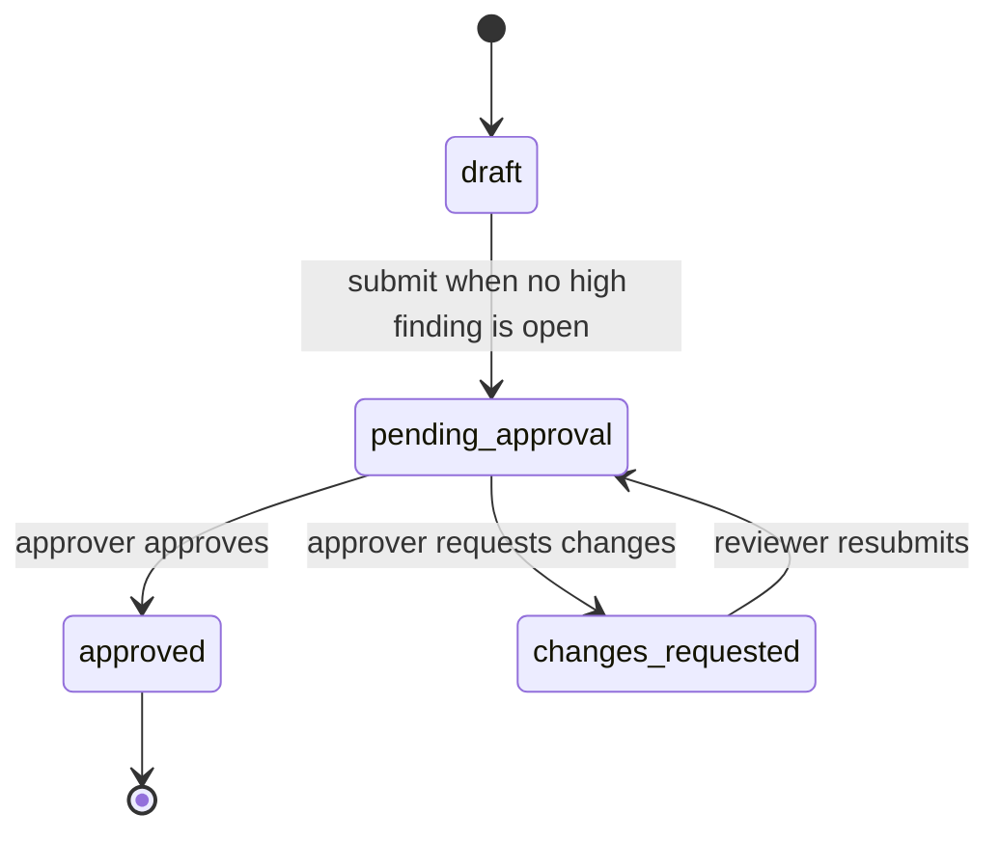

## Overview

BrandGuard AI is a MERN application for checking marketing copy against a curated Rules and Facts library, managing finding status, and routing reviews through a reviewer/approver workflow. The React/Vite client calls the Express API; MongoDB stores users, reviews, rules, facts, and an append-only audit log.

## Data flow

1. A signed-in reviewer submits copy to `POST /api/reviews`; the server stores the deterministic/optional AI findings and a `review_created` audit event.
2. Users can change finding statuses while a review is `draft` or `changes_requested`, and add append-only comments in any workflow state.
3. A reviewer submits with `POST /api/reviews/:id/submit`; an open high-severity finding blocks submission.
4. An approver uses `POST /api/reviews/:id/approve` or `/request-changes`; each transition is conditionally updated and recorded in `AuditLog`.
5. The client reloads the saved review after actions and reads oldest-first audit pages from `GET /api/reviews/:id/audit`.

## Key decisions

- Finding comments are embedded in their finding because they are always read and written with that review; author name and role are snapshots.
- `AuditLog` is a separate append-only collection so activity remains a durable history as review status changes.
- The review workflow uses conditional updates on the expected state to prevent duplicate simultaneous submissions or decisions.
- JWTs live in client local storage; each API call attaches the bearer token. Public review and audit responses do not include email or password hashes.

## Data model

- **Rules** and **Facts** are separate MongoDB collections so approved guidance and verified claims can be maintained and queried independently. Each uses a unique code as a stable evidence reference.
- **Users** store a name, unique email, password hash, and the `reviewer` or `approver` role. Password hashes are excluded from normal queries and public user responses omit email.
- **Reviews** store submitted text, the brand name, findings, summary counts, workflow state, creator/submission/decision references, timestamps, and the current decision note. Findings are embedded subdocuments because they belong to one review; each contains status history fields and an append-only comments array with author, author-name/role snapshots, text, and timestamp.
- **AuditLog** stores one immutable document per event: review/finding references, actor name and role snapshots, action, transition values, matched-text excerpt, optional note, and creation time. It has no update or delete path.

### Approval workflow and permissions



Finding status changes are available in `draft` and `changes_requested`. They are locked in `pending_approval` and `approved`. Finding comments are allowed in every state. Resubmission retains the previous decision fields until a new approver decision replaces them; the audit log preserves each transition.

| Capability | Reviewer | Approver |
|---|---|---|
| Create a review and read review/history data | Yes | Yes |
| Change finding status in draft or changes requested | Yes | Yes |
| Add a finding comment in any workflow state | Yes | Yes |
| Submit or resubmit a review | Yes | Yes |
| Approve or request changes while pending | No | Yes |
| Read the review audit trail | Yes | Yes |

## Review engine

The deterministic review pipeline splits submitted text into sentences while preserving source offsets, checks each sentence against active brand rules, identifies factual claims, and compares those claims to the approved Facts library. It then combines and de-duplicates findings, suppresses redundant verification warnings when a fact mismatch already explains a sentence, sorts findings by source position, and calculates severity and verification counts.

Deterministic checks run first so explicit brand rules and approved facts provide repeatable, auditable results. A claim is only called a fact mismatch when a relevant approved fact exists and its numbers disagree; without supporting evidence, it is marked “Needs verification” rather than false. Each finding links to the matching Rule or Fact code and evidence excerpt when available.

The review engine runs deterministic checks first, then optionally invokes the AI layer. AI findings are advisory additions; deterministic findings take precedence when spans overlap. The Gemini output validator requires verbatim text and a known Rule/Fact code, or `needs_verification` with no evidence code. Invalid JSON, unknown codes, unsupported text spans, timeouts, and provider failures produce deterministic-only results with `aiStatus: unavailable`. Turning the toggle off skips provider calls (`aiStatus: disabled`).

### AI-assisted analysis and guardrails

`services/ai/aiProvider.js` wraps Google's official `@google/genai` Node SDK and selects `AI_MODEL` from server environment configuration (default `gemini-3.8-flash`). `aiAnalyzer.js` makes at most one structured analysis call and one batched rewrite call per review, each with a 15-second timeout. The prompt focuses on nuanced tone, paraphrased or implied claims, and sentence-specific suggestions. The validator strips optional Markdown fences, parses JSON, verifies evidence codes and exact source text, derives offsets from the original input, and removes deterministic duplicates/overlaps. Rewrites are returned as drafts and are never considered evidence or approval.

AI is enabled by default in the input panel but can be disabled per review. API keys remain server-side. Input is limited to 10,000 characters and review creation is rate-limited. Each provider call logs elapsed time. Any AI failure leaves deterministic findings available and records `aiStatus: unavailable`; the UI explains this fallback. AI outputs can still be incomplete or make poor editorial suggestions, so reviewers must verify suggestions before publication.

## Frontend

`AuthProvider` restores the current user through `/api/auth/me` and exposes login, registration, logout, and loading state. Guest routes provide `/login` and `/register`; a protected shell guards Review, History, Rules, and Facts. `ReviewPage` coordinates saved review state, finding filters, status updates, workflow actions, comments, the workflow summary, and the paginated audit trail.

`HighlightedText` partitions the original input at finding offset boundaries, then renders each text segment once. Overlapping findings share a segment instead of duplicating source text; selecting a segment/card links the two panes and marks the active item. Findings retain the API's offsets and are never applied as text replacements.

The API client adds the bearer token automatically and clears the local session on unauthorized responses (except failed login/registration). Finding detail is shared by board cards and text highlights and includes the persisted comment thread. Audit trail pagination and action filtering are client-side over the oldest-first API pages; refreshes after page actions keep the timeline aligned with the stored review.

## Design system and frontend structure

The client dashboard uses CSS custom properties in `client/src/index.css`. Dark is the stylesheet default; on first visit the theme follows `prefers-color-scheme`, then the choice is stored in `localStorage` (`brandguard-theme`).

### Tokens

| Token | Dark | Light |
|---|---|---|
| `--bg` | `#0E0E0E` | `#F5F5F0` |
| `--surface` | `#171717` | `#FFFFFF` |
| `--surface-raised` | `#202020` | `#FFFFFF` |
| `--line` | `#F5F5F0` | `#0E0E0E` |
| `--ink` | `#F5F5F0` | `#0E0E0E` |
| `--muted` | `#9B9B93` | `#5C5C55` |
| `--accent` | `#C8F04A` | `#A6D420` |
| `--mismatch` | `#FF6B5B` | `#D9503F` |
| `--verification` | `#B9A6FF` | `#6A57C9` |
| `--success` | `#6FCF97` | `#2F6F5E` |

Typography uses Space Grotesk with system sans-serif fallbacks and JetBrains Mono for metadata. The existing visual language uses square corners, strong borders, high-contrast tokens, and compact transitions.

### Component tree

```
BrowserRouter
└─ AuthProvider
   └─ App / ThemeProvider
      ├─ Guest routes: Login and Register
      └─ ProtectedRoute → Shell
         ├─ TopBar (search, signed-in user/role, logout, New review)
         └─ routes
            ├─ ReviewPage
            │  ├─ WorkflowSummary and status/action panel
            │  ├─ Tabs (Board view / Text view / Audit trail)
            │  ├─ FindingsBoard → Column → FindingCard (comment count)
            │  ├─ SummaryBar + HighlightedText + ScoreRing
            │  ├─ Drawer → FindingDetail → CommentsThread
            │  └─ AuditTrail (filters, copy, pagination)
            ├─ HistoryPage (creator, workflow status/filter)
            ├─ RulesPage
            └─ FactsPage
```

Supporting primitives: `Pill`, `Card`, `IconButton`, `Tabs`, `Drawer`, `Toast`, `ScoreRing`. Finding type labels (`Banned term`, `Fact mismatch`, `Needs verification`, and related rule types) live in `client/src/utils/findingLabels.js`.

The review board uses dnd-kit pointer and keyboard sensors. Dropping a finding on another status column optimistically updates its local status, calls `PATCH /api/reviews/:id/findings/:findingId`, and restores the previous review with a toast if the request fails. Status controls and drag/drop are disabled for pending and approved reviews, while comment posting stays enabled. Text highlights use deterministic review offsets and partition overlapping ranges so source text is rendered once; each highlight start includes an icon and type label so color is not the only signal.

Compliance score is `max(0, 100 − penalties)` with weights high=10, medium=5, low=2, needs-verification=4.

## Deployment

The API is deployed as a Render Node web service, with `PORT` supplied by the host and the process bound to `0.0.0.0`. The Vite-built React client is hosted on Vercel with an SPA rewrite so review/history routes work on refresh. MongoDB Atlas provides the managed database. This keeps frontend delivery/CDN and API runtime independently deployable while environment variables connect the client, API, and database without committing secrets.

The backend CORS allowlist is configured from comma-separated `CLIENT_URL` origins and allows `Authorization` requests. Set the exact Vercel origin in Render's `CLIENT_URL`; no deployment origin is hard-coded in the server. The Vercel build receives its API base URL through `VITE_API_URL`. MongoDB, JWT signing, AI, and seed credentials remain in Render's secret environment settings, never in the repository. Health responses expose MongoDB connection state. Production seeding requires `--confirm`, `SEED_DEMO_PASSWORD`, and the intended database URI; it only inserts missing seed records and is safe to rerun.
